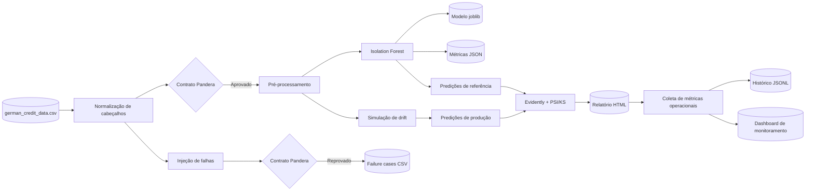

# Drift Detect · Etapas 1, 2 e 3

> Validação, baseline não supervisionado e detecção de drift no German Credit Data  
> Tech Challenge — Machine Learning Engineering, Fase 4

## Visão geral

O projeto usa diretamente `dataset/german_credit_data.csv`, com 1.000 registros de
crédito. O CSV original permanece intacto. Na leitura, o pipeline normaliza apenas os
nomes das colunas para o padrão `snake_case`, valida o contrato antes do treinamento e
cria um lote contaminado separado para demonstrar o bloqueio de dados inválidos.

O arquivo fornecido não contém uma variável-alvo de inadimplência ou risco. Por isso, o
baseline é um `IsolationForest`, adequado à detecção não supervisionada de perfis
atípicos. O projeto não fabrica rótulos nem apresenta ROC AUC, F1 ou acurácia sem um
ground truth.

Na Etapa 2, o pipeline cria um lote de produção determinístico, deslocando
intencionalmente `age` e `credit_amount`, gera predições com o baseline e compara esse
lote com a referência. O Evidently produz o relatório interativo, enquanto um resumo
auditável registra PSI para todas as variáveis e Kolmogorov-Smirnov para as numéricas.

Na Etapa 3, cada comando também produz logs estruturados em JSON Lines. Uma execução
monitorada mede status, latência, volume processado e alertas por tarefa, preserva o
histórico entre execuções e atualiza um dashboard HTML autocontido. Assim, a solução
pode ser demonstrada localmente sem conta em serviço externo ou infraestrutura ativa.

## Fluxo



## Execução rápida

Pré-requisitos: Python 3.11 a 3.13 e `uv`.

No Windows:

```powershell
powershell -ExecutionPolicy Bypass -File .\scripts\run_stage1.ps1
powershell -ExecutionPolicy Bypass -File .\scripts\run_stage2.ps1
powershell -ExecutionPolicy Bypass -File .\scripts\run_stage3.ps1
```

No Linux ou macOS:

```bash
sh scripts/run_stage1.sh
sh scripts/run_stage2.sh
sh scripts/run_stage3.sh
```

Execução manual:

```bash
uv sync --extra dev

# Valida o CSV original e cria apenas o lote inválido separado
uv run drift-detect prepare

# Valida o dataset original
uv run drift-detect validate dataset/german_credit_data.csv

# Treina o detector não supervisionado
uv run drift-detect train

# Executa validação, treino e demonstração de rejeição
uv run drift-detect demo

# Simula produção, gera predições e produz o relatório de drift
uv run drift-detect drift

# Executa o pipeline completo com métricas, histórico e dashboard operacional
uv run drift-detect monitor
```

## Dados e contrato

O cabeçalho vazio do CSV, lido pelo pandas como `Unnamed: 0`, é normalizado para
`customer_id`. As demais colunas também recebem nomes internos estáveis. Os valores
`NA` de contas de poupança e corrente são tratados como ausentes legítimos: são 183 e
394 ocorrências, respectivamente.

| Coluna interna | Coluna original | Regra principal |
|---|---|---|
| `customer_id` | cabeçalho vazio | inteiro não negativo e único |
| `age` | `Age` | 18 a 100 |
| `sex` | `Sex` | `female` ou `male` |
| `job` | `Job` | código 0, 1, 2 ou 3 |
| `housing` | `Housing` | `free`, `own` ou `rent` |
| `saving_accounts` | `Saving accounts` | categoria conhecida ou nulo |
| `checking_account` | `Checking account` | categoria conhecida ou nulo |
| `credit_amount` | `Credit amount` | inteiro positivo |
| `duration` | `Duration` | 1 a 120 meses |
| `purpose` | `Purpose` | uma das oito categorias observadas |

O contrato `german_credit_contract_v1` também rejeita colunas extras ou ausentes,
IDs repetidos e linhas exatamente duplicadas. A validação usa `lazy=True` para reunir
todas as violações em uma única execução.

## Baseline

O pipeline contém:

1. validação obrigatória do dataset;
2. imputação pela mediana e padronização de idade, valor e duração;
3. imputação pela moda e one-hot encoding das variáveis categóricas;
4. `IsolationForest` com semente fixa e contaminação de 5%;
5. persistência conjunta do pré-processamento e do detector.

O relatório registra quantidade e taxa de anomalias, contaminação configurada,
estatísticas do score, tamanho do dataset, semente e horário UTC. Essas medidas
descrevem o detector; não são métricas de qualidade preditiva.

## Simulação e detecção de drift

O lote de produção mantém as 1.000 identidades e todas as categorias da referência,
mas aplica duas mudanças econômicas reproduzíveis:

- `age = round(min(100, age * 1.20 + 5))`;
- `credit_amount = round(min(2.000.000, credit_amount * 1.80 + 1.000))`.

O lote transformado passa novamente pelo contrato Pandera antes da inferência. O modelo
gera `anomaly_score` e `anomaly_label` tanto para referência quanto para produção. A
comparação usa PSI com limiar `0.1` no Evidently e no resumo JSON; para as variáveis
numéricas, o pipeline também executa KS com `alpha = 0.05`. O identificador
`customer_id` é mapeado como ID e excluído do cálculo de drift.

Esses resultados medem mudança de distribuição e de comportamento do detector. Como o
CSV não possui alvo real, eles não demonstram concept drift nem queda de qualidade
preditiva; isso exigiria rótulos observados ao longo do tempo.

## Observabilidade operacional

O comando `monitor` executa três tarefas observáveis: validação do contrato, verificação
de prontidão do modelo (treino ou reutilização) e análise de drift. Cada execução recebe
um `run_id` e registra:

- status geral e por tarefa (`success` ou `failed`);
- latência total e de cada tarefa em segundos;
- volume de registros processados;
- quantidade de alertas e features com drift;
- taxas de anomalia da referência e da produção;
- tipo, mensagem e etapa da falha, quando houver.

Os eventos de todos os comandos da CLI são centralizados em `pipeline.jsonl`. As
métricas de cada execução monitorada são acrescentadas a `metrics_history.jsonl`, sem
apagar o histórico anterior. O dashboard interativo mostra os indicadores da última
execução, os testes PSI/KS, até 20 execuções recentes e permite filtrar o histórico por
status. Um alerta de drift descreve degradação
estatística, não falha técnica: por isso a execução pode terminar com status de sucesso
e, ao mesmo tempo, exibir alertas que exigem investigação.

## Artefatos

| Caminho | Descrição |
|---|---|
| `dataset/german_credit_data.csv` | dataset original e imutável |
| `data/invalid/german_credit_invalid_batch.csv` | lote contaminado para a prova de bloqueio |
| `artifacts/model/german_credit_anomaly_pipeline.joblib` | pipeline não supervisionado treinado |
| `artifacts/reports/validation_report.json` | resultado da validação da referência |
| `artifacts/reports/baseline_metrics.json` | métricas descritivas do detector |
| `artifacts/reports/invalid_failure_cases.csv` | violações que bloquearam o lote inválido |
| `data/production/german_credit_drifted.csv` | lote válido com drift injetado em duas features |
| `artifacts/predictions/production_predictions.csv` | predições e scores do lote de produção |
| `artifacts/reports/drift_report.html` | relatório interativo do Evidently |
| `artifacts/reports/evidently_drift_report.json` | saída estruturada do Evidently |
| `artifacts/reports/drift_summary.json` | PSI, KS, limiares e colunas detectadas |
| `artifacts/observability/pipeline.jsonl` | logs estruturados centralizados da CLI |
| `artifacts/observability/metrics_history.jsonl` | histórico de saúde das execuções monitoradas |
| `artifacts/reports/monitoring_dashboard.html` | dashboard operacional autocontido da Etapa 3 |

## Qualidade

```bash
uv run pytest
uv run ruff check .
```

Os testes usam o próprio `german_credit_data.csv`, verificam a normalização dos
cabeçalhos, os nulos permitidos, as regras categóricas e numéricas, o acúmulo de
falhas, a criação de um pipeline carregável, a simulação válida e a detecção das duas
features intencionalmente deslocadas. Também cobrem a leitura resiliente do histórico
de monitoramento e a presença dos indicadores operacionais no dashboard.

## Limitação conhecida

Para voltar a um classificador supervisionado de risco de crédito, é necessário
fornecer uma coluna-alvo confiável, por exemplo `Risk` ou `defaulted`, com a definição
da classe positiva documentada. Sem isso, qualquer rótulo derivado das próprias
features seria circular e produziria uma avaliação enganosa.
